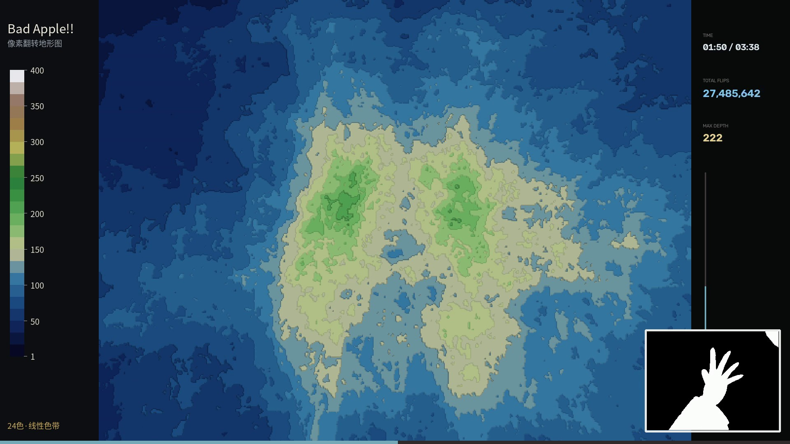
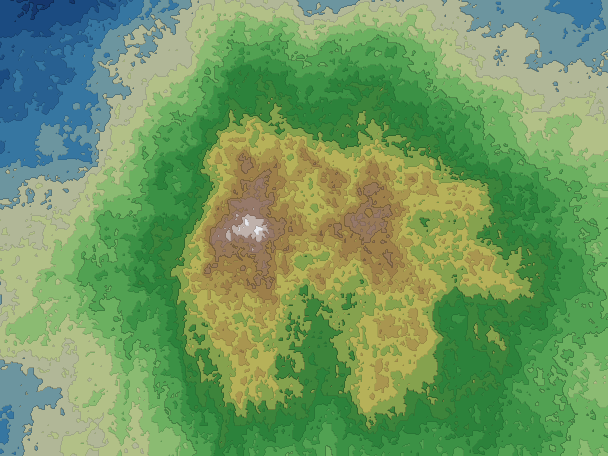
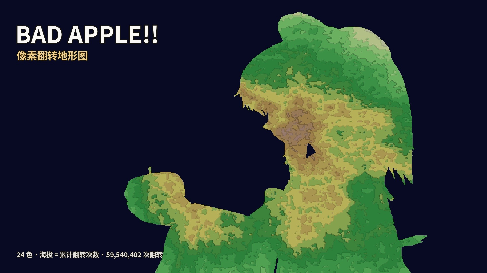

# terrainify

把任意视频变成一张逐渐隆起的等高线地形图视频。每个像素的"海拔"是它在整段视频里黑白翻转的累计次数——画面越是闪动的区域，山脉隆起越高；播完那一刻，整部视频凝固成一张完整地形图。

Turn any video into a contour-line terrain map that rises as the video plays. Each pixel's "elevation" is its cumulative black↔white flip count — regions that flicker more build higher mountains, and when playback ends the whole video freezes into a finished terrain map.

| 成片画面（左图例 / 中央地形 / 右下角原片对照） | 播完定格的最终地形 | 封面 |
|---|---|---|
|  |  |  |

示例素材为《Bad Apple!!》PV（源视频与音乐版权归原作者，本仓库不分发任何素材）。

The demo footage is the *Bad Apple!!* PV (source video and music belong to their original copyright holders; this repository does not distribute any of their material).

## 原理 / How it works

1. 视频逐帧二值化后做帧间差分，累计每个像素的黑白翻转次数——这是一张随时间只增不减的"深度场"。
2. 翻转次数映射为海拔，按 12 锚点地形调色板（深海 → 沙滩 → 森林 → 岩灰 → 雪）分 24 级着色，相邻级别之间描单像素等高线，每 4 级一条更深的计曲线。
3. 色标从开播起锁定（1 到全片最高翻转数），地形随播放逐渐隆起，等高线随各处累计计数实时演化。

1. Each frame is binarized and differenced against the previous one, accumulating a per-pixel flip-count "depth field" that only grows over time.
2. Flip counts map to elevation and are colored through a 12-anchor terrain palette (deep sea → beach → forest → rock gray → snow) in 24 levels, with single-pixel contour lines between adjacent levels and a darker index contour every 4 levels.
3. The color scale locks at the start (1 to the video's max flip count); the terrain rises as playback proceeds and contour lines evolve with the accumulating counts.

统计量（总翻转数、时间、最深像素）实时显示在右栏，右下角画中画为原片对照。

Live stats (total flips, elapsed time, deepest pixel) run in the right panel, with a picture-in-picture of the original video in the corner.

## 安装 / Install

- Python 3.10+
- ffmpeg（系统安装，如 `sudo apt install ffmpeg`）
- Noto Sans CJK 字体（渲染中文标签，如 `sudo apt install fonts-noto-cjk`；缺失时回退默认字体，中文将不可读）

```bash
pip install -r requirements.txt
```

- Python 3.10+
- ffmpeg (system package, e.g. `sudo apt install ffmpeg`)
- Noto Sans CJK fonts (for the Chinese labels, e.g. `sudo apt install fonts-noto-cjk`; falls back to the default font when missing, which cannot render Chinese)

```bash
pip install -r requirements.txt
```

## 快速开始 / Quick start

对你自己的视频三步出片（中间产物按输入文件名派生：`video.mp4` → `video_counts.npy` + `video_stats.json`）：

Three steps from your own video to a rendered terrain (intermediate files derive from the input name: `video.mp4` → `video_counts.npy` + `video_stats.json`):

```bash
# 1. 第一遍：全片扫描，统计翻转深度场（长视频约几分钟）
python3 make_video.py analyze --input video.mp4

# 2. 第二遍：渲染成片（1920x1080，源有音轨则保留原声）
python3 make_video.py render --input video.mp4 --scale linear --smooth 1 \
    --levels 24 --title "My Video" --out my_terrain.mp4

# 3. 可选：播完定格地形生成封面
python3 make_cover.py --input video.mp4 --title "MY VIDEO" --out cover.jpg
```

黑白对比强烈、画面持续翻转的视频（手绘动画、像素动画、打字机字幕）效果最好；缓慢渐变的实拍视频地形会很平坦。

High-contrast, constantly flipping footage (hand-drawn animation, pixel art, typewriter captions) works best; slow, gradient live-action footage ends up mostly flat.

## 示例：Bad Apple!! / Demo: Bad Apple!!

示例成片使用的源片为 640×480 / 30fps 的《Bad Apple!!》PV，边缘有低活跃暗带，用 `--crop` 裁掉防止贴边黑带。**源视频请自行获取**（版权原因不随仓库分发），例如从 B 站 [BV1Wx411c7JT](https://www.bilibili.com/video/BV1Wx411c7JT) 下载，命名为 `source.mp4` 放在仓库根目录：

The demo uses the 640×480 / 30fps *Bad Apple!!* PV. Its borders are low-activity dark bands, trimmed with `--crop` so they don't flatten into edge darkness. **Fetch the source yourself** (copyright — not distributed here), e.g. from bilibili [BV1Wx411c7JT](https://www.bilibili.com/video/BV1Wx411c7JT), and save it as `source.mp4` in the repo root:

```bash
# 用 yt-dlp 也可以：yt-dlp "https://www.bilibili.com/video/BV1Wx411c7JT" -o source.mp4
python3 make_video.py analyze --input source.mp4 --crop 16,12,624,468
python3 make_video.py render --input source.mp4 --crop 16,12,624,468 \
    --scale linear --smooth 1 --levels 24 --title "Bad Apple!!" \
    --tag "24 levels" --out badapple_terrain.mp4
python3 make_cover.py --input source.mp4 --title "BAD APPLE!!" --out cover.jpg
```

复现结果：6551 帧、全片 59,540,402 次像素翻转、最深像素翻转 400 次。

Reproduced result: 6,551 frames, 59,540,402 pixel flips across the video, 400 flips for the deepest pixel.

## 参数 / Options

| 参数 | 默认 | 说明 |
|---|---|---|
| `--input` | 必填 | 源视频路径，analyze / render / make_cover 须一致 |
| `--crop` | 不裁剪 | 边缘裁剪 `left,top,right,bottom`，剔除信箱黑边等低活跃区域 |
| `--scale` | 必填 | `linear` 固定线性刻度（全程不刷新）或 `quantile` 分位刻度 |
| `--levels` | 24 | 色带级数（12 锚点插值；400 级渐变见下） |
| `--smooth` | 0 | 1 = 计数场 3×3 高斯轻平滑，等高线更圆润 |
| `--major-every` | 4 | 每 N 级一条计曲线，0 关闭 |
| `--fine-contours` | 1 | 0 = 关闭逐级细线，密集渐变时只留计曲线 |
| `--title` | Flip Terrain | 成片左栏主标题 |
| `--tag` | 空 | 左栏底部的版本标签 |
| `--frames` / `--start` | 全片 / 0 | 渲染前 N 帧 / 从第 N 帧起渲染，快速出小样 |
| `--live` | 0 | 1 = 动态分位色标，每帧按当前分布重切（连续演化，与固定刻度是两种观感） |

| Option | Default | Description |
|---|---|---|
| `--input` | required | Source video path; keep it identical across analyze / render / make_cover |
| `--crop` | none | Edge crop `left,top,right,bottom` to drop low-activity borders like letterboxing |
| `--scale` | required | `linear` fixed scale (locked all the way) or `quantile` percentile scale |
| `--levels` | 24 | Number of color bands (interpolated from 12 anchors; see below for 400) |
| `--smooth` | 0 | 1 = light 3×3 Gaussian smoothing on the count field for rounder contours |
| `--major-every` | 4 | Index contour every N levels; 0 disables |
| `--fine-contours` | 1 | 0 = drop per-level thin lines, keep only index contours (for dense gradients) |
| `--title` | Flip Terrain | Main title in the left panel |
| `--tag` | empty | Version tag at the bottom of the left panel |
| `--frames` / `--start` | all / 0 | Render first N frames / start at frame N, for quick samples |
| `--live` | 0 | 1 = live percentile scale recomputed every frame (a different look from the fixed scale) |

**400 级渐变版**：`--levels 400 --major-every 44 --fine-contours 0` 得到接近连续的地形渐变，仅保留稀疏计曲线。调色板插值会在 8 位通道取整的重色中挑选最接近的未用颜色，保证 400 档各不相同。

**400-level gradient**: `--levels 400 --major-every 44 --fine-contours 0` yields a near-continuous gradient with sparse index contours only. Palette interpolation resolves 8-bit rounding collisions by picking the nearest unused color, keeping all 400 levels distinct.

## 布局说明 / Layout notes

成片固定 1920×1080：左右各 240px 信息栏，中央 1440×1080（4:3）地形区。非 4:3 源视频会被最近邻缩放进中央区（16:9 源左右略压扁），等高线的密度信息不受影响。

Output is fixed at 1920×1080: 240px side panels flanking a 1440×1080 (4:3) terrain area. Non-4:3 sources are nearest-neighbor scaled into it (16:9 sources get slightly squeezed horizontally); contour density information is unaffected.

## 测试 / Tests

```bash
python3 -m unittest discover -s tests -v
```

覆盖调色板去重、等高线单像素线宽、计曲线亮度钳制、真实计数样本的描边不粘连、最终地形固定刻度。

Covers palette dedup, single-pixel contour width, index-contour brightness clamping, no-black-bands on a real count sample, and the final terrain's fixed scale.

## 许可与致谢 / License & credits

代码以 [MIT](LICENSE) 许可开源。示例引用的《Bad Apple!!》feat.nomico（Alstroemeria Records）及 PV 画面版权归属各原作者，本项目仅为可视化技术演示；使用本工具发布的衍生内容请遵守源素材版权并致谢原作。

The code is released under the [MIT](MIT) license. *Bad Apple!!* feat.nomico (Alstroemeria Records) and the PV imagery belong to their original copyright holders; this project is a visualization tech demo only. Derivative works you publish with this tool must respect the source material's copyright and credit the original authors.
